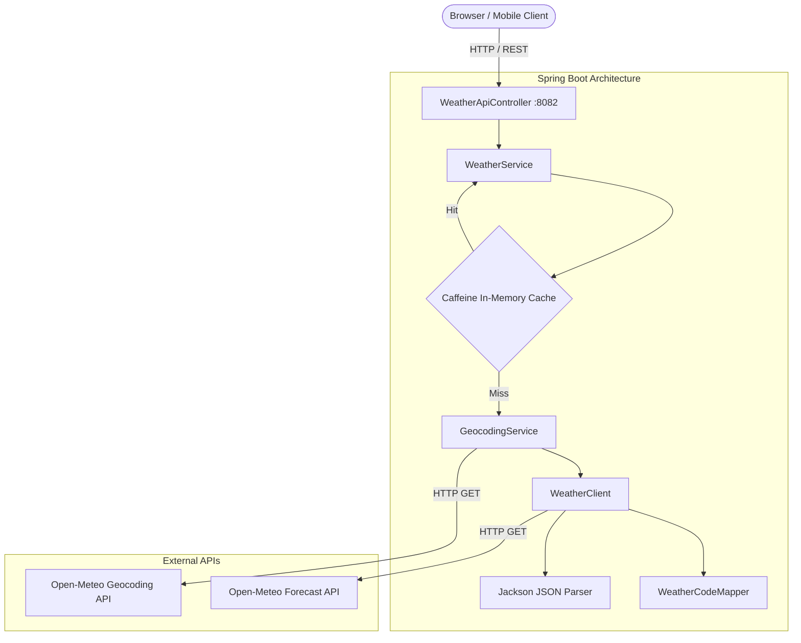

# ⛅ SkyPulse | Real-Time Weather Forecast Application

[](https://openjdk.org/)
[](https://spring.io/projects/spring-boot)
[](http://localhost:8082/swagger-ui.html)
[](https://www.docker.com/)
[](LICENSE)

A production-ready **Weather Forecast Application** engineered with **Java (Spring Boot 3)**, integrating live REST APIs, high-performance **Jackson JSON parsing**, and in-memory **Caffeine caching**. Provides real-time atmospheric metrics (temperature, humidity, wind, pressure, UV index), a 5-day daily forecast with precipitation probabilities, a 24-hour hourly trend slider, and a modern glassmorphic web dashboard.

---

## ✨ Features

- **🌐 Live REST API Integration**: Queries global meteorological satellite models via Open-Meteo REST API without requiring complex API keys or credit card setups.
- **⚡ High-Speed In-Memory Caching**: Implements a Caffeine cache layer with a 15-minute TTL to minimize latency, respect rate limits, and provide sub-millisecond repeated queries.
- **🔍 Intelligent City Geocoding & Autocomplete**: Debounced live search autocomplete converts any global city, state, or country name into geographic coordinates.
- **📍 GPS Geolocation**: Includes "Locate Me" button with HTML5 Geolocation API support to fetch immediate local weather.
- **🌡️ Comprehensive Weather Metrics**:
  - Current ambient temperature & "Feels Like" index.
  - Relative Humidity percentage.
  - Wind speed & direction.
  - Atmospheric surface pressure (hPa).
  - UV Index ratings.
- **📅 5-Day Extended Forecast**: Day-by-day high/low temperature bars, precipitation chance, sunrise/sunset times, and WMO weather condition icons.
- **⏰ 24-Hour Hourly Timeline**: Interactive hourly forecast showing temperature fluctuations and rain likelihood over the next 24 hours.
- **🔄 Dual Units Mode**: Instant toggle between Metric (°C, km/h) and Imperial (°F, mph).
- **🎨 Glassmorphic Ambient Dashboard**: Responsive, dark-mode dashboard with frosted glass blur effects and dynamic atmospheric ambient lighting matching current weather.
- **📖 Interactive OpenAPI / Swagger UI**: Built-in developer documentation at `/swagger-ui.html`.
- **🐳 Dockerized Deployment**: Multi-stage Docker build ready for instantaneous containerized deployment.

---

## 🏛️ System Architecture



---

## 🚀 Quick Start Guide

### Option 1: Run with Docker Compose (Recommended)

```bash
# Clone the repository
git clone https://github.com/your-username/weather-forecast-application.git
cd weather-forecast-application

# Launch container
docker-compose up --build -d
```

- **Interactive Dashboard**: [http://localhost:8082](http://localhost:8082)
- **Swagger UI**: [http://localhost:8082/swagger-ui.html](http://localhost:8082/swagger-ui.html)

To stop:
```bash
docker-compose down
```

---

### Option 2: Run Locally with Maven

```bash
# Navigate to project folder
cd weather-forecast-application

# Build and start Spring Boot app
mvn spring-boot:run
```

Access the application at [http://localhost:8080](http://localhost:8080) (or configured port in `application.yml`).

---

## 📡 REST API Reference

### 1. Get Full Weather Report
- **GET** `/api/v1/weather/report?city={city}&unit={metric|imperial}`
- **Example**: `/api/v1/weather/report?city=Tokyo&unit=metric`
- **Response** (`200 OK`):
```json
{
  "success": true,
  "message": "Success",
  "data": {
    "location": {
      "name": "Tokyo",
      "country": "Japan",
      "countryCode": "JP",
      "admin1": "Tokyo",
      "latitude": 35.6895,
      "longitude": 139.6917,
      "timezone": "Asia/Tokyo"
    },
    "current": {
      "temperature": 18.5,
      "feelsLike": 17.8,
      "humidity": 58,
      "windSpeed": 12.3,
      "pressure": 1016.0,
      "uvIndex": 4.5,
      "weatherCode": 1,
      "condition": "Mainly Clear",
      "icon": "fa-cloud-sun",
      "day": true,
      "observationTime": "2026-11-13T12:00"
    },
    "dailyForecast": [
      {
        "date": "2026-11-13",
        "dayOfWeek": "Today",
        "minTemp": 12.4,
        "maxTemp": 19.8,
        "precipitationProbability": 15,
        "weatherCode": 1,
        "condition": "Mainly Clear",
        "icon": "fa-cloud-sun",
        "sunrise": "2026-11-13T06:14",
        "sunset": "2026-11-13T16:35"
      }
    ],
    "hourlyForecast": [
      {
        "time": "12:00",
        "temperature": 18.5,
        "humidity": 58,
        "precipitationProbability": 10,
        "weatherCode": 1,
        "condition": "Mainly Clear",
        "icon": "fa-cloud-sun"
      }
    ],
    "unit": "metric",
    "fetchedAt": "2026-11-13T12:00:00",
    "cached": false
  }
}
```

### 2. Get Current Weather Only
- **GET** `/api/v1/weather/current?city=London&unit=metric`
- **Response** (`200 OK`): Returns `CurrentWeatherDto` object with temperature, humidity, wind, and conditions.

### 3. Get 5-Day Forecast
- **GET** `/api/v1/weather/forecast?city=Paris&days=5&unit=metric`
- **Response** (`200 OK`): Returns array of 5 daily forecast objects.

### 4. Search Cities for Autocomplete
- **GET** `/api/v1/weather/search?query=San`
- **Response** (`200 OK`):
```json
{
  "success": true,
  "data": [
    {
      "name": "San Francisco",
      "country": "United States",
      "countryCode": "US",
      "admin1": "California",
      "latitude": 37.7749,
      "longitude": -122.4194
    }
  ]
}
```

### 5. Query by GPS Coordinates
- **GET** `/api/v1/weather/coordinates?lat=40.7128&lon=-74.0060&unit=imperial`

---

## 🧪 Testing

Execute the automated JUnit 5 tests:

```bash
mvn test
```

---

## 🛠️ Tech Stack

| Component | Technology |
|---|---|
| **Language & Framework** | Java 17+, Spring Boot 3.2.5 (Spring MVC) |
| **Caching Layer** | Caffeine Cache (`@Cacheable`, 15-min TTL) |
| **HTTP Client** | Spring `RestTemplate` (Configured timeouts & connection pooling) |
| **JSON Processing** | Jackson `ObjectMapper` / `JsonNode` |
| **Documentation** | Springdoc OpenAPI 3.0 / Swagger UI |
| **Deployment** | Docker (Multi-stage build), Docker Compose |
| **Frontend** | Vanilla JavaScript (ES6+), Glassmorphic CSS3, FontAwesome 6 |

---

## 📄 License

This project is licensed under the MIT License.

